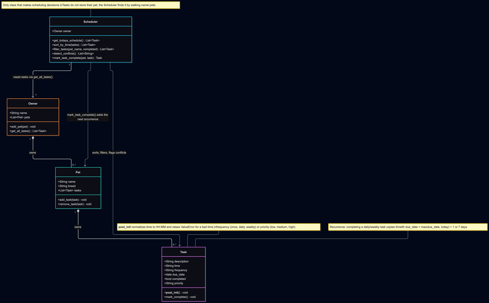

# PawPal+

**PawPal+** is a Streamlit app that helps a busy pet owner keep up with pet care. The owner adds pets and care tasks (walks, feeding, meds, grooming), and the app builds a sorted schedule for today, warns about tasks booked at the same time, and automatically schedules the next occurrence of daily and weekly tasks.

## What it does

- Lets a user enter owner and pet info and add tasks with a time, frequency and priority.
- Shows today's schedule sorted by time, with higher priority first on ties.
- Warns when two open tasks share a date and time, for one pet or several.
- Filters tasks by pet and by completion status.
- Creates the next daily or weekly task when one is marked done.
- Is covered by an automated test suite of the scheduling rules (see [Testing PawPal+](#-testing-pawpal)).

Scheduling is by exact `"HH:MM"` start time. Task durations and overlapping time ranges are intentionally out of scope.

## Architecture



Mermaid source: [`diagrams/uml_final.mmd`](diagrams/uml_final.mmd).

## Implementation summary

The core logic lives in `pawpal_system.py` (no UI dependencies), with `main.py` as a CLI demo and `tests/test_pawpal.py` for unit tests.

- **`Task`**: a dataclass for one care item (description, `"HH:MM"` time, frequency of `once`/`daily`/`weekly`, due date, priority, completed flag). `mark_complete()` sets its status.
- **`Pet`**: a dataclass that owns a list of `Task`s and exposes `add_task()` / `remove_task()`.
- **`Owner`**: a dataclass that owns a list of `Pet`s. `get_all_tasks()` flattens every pet's tasks into one list.
- **`Scheduler`**: takes an `Owner` and works over `owner.get_all_tasks()`. It builds today's schedule (incomplete tasks due today, sorted by time), filters by pet and/or completion, detects conflicts (tasks sharing a date and time), and handles recurrence: `mark_task_complete()` completes a task and, for `daily`/`weekly` tasks, adds a copy due `max(due_date, today)` + 1 or 7 days to the pet.

Flow: `Owner` → has many `Pet` → has many `Task`; `Scheduler` reads across that hierarchy and is the only class that makes scheduling decisions.

## Features

- **Sorting by time:** `Scheduler.sort_by_time()` orders tasks by `"HH:MM"`. Times are normalized to zero-padded form so `"9:00"` sorts before `"18:00"`; ties go to the higher priority.
- **Today's schedule:** `Scheduler.get_todays_schedule()` returns incomplete tasks due today, sorted.
- **Filtering:** `Scheduler.filter_tasks()` filters by pet name (case-insensitive), by completion status, or both.
- **Conflict warnings:** `Scheduler.detect_conflicts()` groups open tasks by date and time and returns one readable warning per clash, naming each pet and task. It covers one pet or several and never raises. Completed tasks are ignored.
- **Daily and weekly recurrence:** `Scheduler.mark_task_complete()` completes a task and creates the next one at `max(due_date, today)` + 1 day (daily) or 7 days (weekly), using `timedelta`. Completing a task twice does not duplicate it.
- **Next available slot:** `Scheduler.next_available_slot()` finds the first free `HH:MM` on a date (15-minute steps by default, ignoring completed tasks). `detect_conflicts(suggest=True)` uses it to end each warning with a suggested free slot.
- **Data persistence:** `Owner.save_to_json()` and `Owner.load_from_json()` keep pets and tasks in `data.json` between runs.
- **Input validation:** `Task` rejects malformed times and unknown frequencies or priorities with `ValueError`.
- **Streamlit UI:** add pets and tasks, see a live sorted schedule with conflict warnings, mark tasks done, and browse tasks with pet and status filters.

## Getting started

### Setup

```bash
python -m venv .venv
source .venv/bin/activate  # Windows: .venv\Scripts\activate
pip install -r requirements.txt
```

### Run

```bash
streamlit run app.py      # web app
python main.py            # CLI demo
python -m pytest          # tests
```

## 🧪 Testing PawPal+

Run the full suite from the project root:

```bash
python -m pytest
```

**What the tests cover** (`tests/test_pawpal.py`, 63 tests):

- **Sorting:** chronological order, zero-padded time normalization, priority tie-breaks, stable order, empty input and `00:00`/`23:59` boundaries.
- **Filtering:** by pet (case-insensitive), by completion status, by both, and for pets or owners with no tasks.
- **Recurring tasks:** daily (+1 day) and weekly (+7 days) next occurrences, late and early completion, chained and repeated completion, and month, year and leap-day rollover.
- **Conflict detection:** same pet, different pets, three-way clashes, separate clashes, different dates, and completed tasks ignored.
- **Next free slot:** empty day, taken slots, completed tasks and other dates ignored, a full day, bad arguments, and conflict warnings with a suggestion.
- **Persistence:** JSON round trip, overwrite without temp files, scheduling on loaded data, a missing file, and corrupt or invalid files.
- **Today's schedule and validation:** only open tasks due today appear; invalid time, frequency and priority raise `ValueError`.

Sample output of a successful run:

```
============================= test session starts ==============================
platform darwin -- Python 3.13.14, pytest-9.1.1, pluggy-1.6.0
rootdir: /Users/soh/Documents/personal/learning/codepath/ai110-module2show-pawpal-starter
plugins: platformdirs-4.12.3, anyio-4.15.1
collected 63 items

tests/test_pawpal.py ................................................... [ 80%]
............                                                             [100%]

============================== 63 passed in 0.07s ==============================
```

**Confidence level: ★★★★☆ (4/5).** All 63 tests pass and cover each scheduling rule, including the date edge cases. I stop at four stars because conflicts only compare exact start times (no durations) and the Streamlit UI has no automated tests.

## 💾 Data Persistence

The app remembers owners, pets and tasks between runs in a `data.json` file next to `app.py`.

**Workflow**

1. On startup, `app.py` calls `Owner.load_from_json("data.json")`. If the file does not exist, it starts with an empty owner.
2. Every change (adding a pet, adding a task, marking a task done) calls `Owner.save_to_json()`, and the script saves once more at the end of each run so edits such as a renamed owner persist too.
3. If `data.json` is corrupt or holds invalid values (for example a time of `"99:99"`), the app moves it to `data.json.bak`, starts fresh and shows a warning instead of crashing.

**How it works.** No serialization library is needed: each class has a small `to_dict()` / `from_dict()` pair (`Task`, `Pet`, `Owner`) that turns objects into plain dicts and back. The only non-JSON type is the due date, which is stored as an ISO string (`"2026-10-17"`) and restored with `date.fromisoformat`. `from_dict` goes through the normal `Task` constructor, so saved data is validated exactly like new input. `save_to_json` writes to a temporary file and then swaps it in with `os.replace`, so a crash mid-write cannot damage the existing file.

**Files modified:** `pawpal_system.py` (`to_dict`, `from_dict`, `save_to_json`, `load_from_json`), `app.py` (load on startup, save after changes, corrupt-file handling), `tests/test_pawpal.py` (round-trip, missing-file and invalid-file tests) and `.gitignore` (`data.json` and `data.json.bak` hold personal data and are not committed). `main.py` is a demo and does not read or write `data.json`.

## 📐 Smarter Scheduling

| Feature | Method(s) | Notes |
|---------|-----------|-------|
| Task sorting | `Scheduler.sort_by_time()`, `Scheduler.get_todays_schedule()` | Sorts by `"HH:MM"` (times are normalized to zero-padded form in `Task.__post_init__`, invalid times raise `ValueError`); ties go to the higher priority. |
| Filtering | `Scheduler.filter_tasks(pet_name, completed)` | Filter by pet name (case-insensitive), completion status, or both. |
| Conflict handling | `Scheduler.detect_conflicts()` | One pass groups open (not completed) tasks by date and time and returns a warning string per clash, naming each pet. Works for one pet or several; it never raises. Only exact start times are compared, not durations. |
| Next free slot | `Scheduler.next_available_slot()`, `Scheduler.detect_conflicts(suggest=True)` | Scans 15-minute slots from a start time and returns the first with no open task; conflict warnings include it. Returns `None` when the day is full. |
| Recurring tasks | `Scheduler.mark_task_complete()` | Completing a `daily`/`weekly` task adds a copy due `max(due_date, today)` + 1 or 7 days (`timedelta`). Completing a task twice does not duplicate it. |

## 📸 Demo Walkthrough

### What the app does

Run `streamlit run app.py`. From the page a user can:

- **Add pets** with a name and breed.
- **Add tasks** to a pet with a description, `HH:MM` time, frequency (`once`, `daily`, `weekly`) and priority. A malformed time shows an error instead of crashing.
- **See today's schedule**, always up to date, sorted by time (higher priority first on ties).
- **See conflict warnings** above the schedule when two open tasks share a date and time, with each pet and task named and a prompt to move one.
- **Mark a task done.** A recurring task shows a message with the date of its next occurrence.
- **Browse all tasks** with a pet filter and a To do / Done / All status filter.

### Example workflow

1. Add a pet, e.g. Rex (Labrador).
2. Add "Walk" at 08:00 (daily, high) and "Feed" at 08:00 (once, medium).
3. Today's schedule lists both, and a warning reports `Conflict at 08:00 ...: Rex: Walk, Rex: Feed`.
4. Mark "Feed" done (or add it again at 09:00 and finish the 08:00 one); the warning clears and a green "No scheduling conflicts." appears.
5. Mark "Walk" done: the message says the next Walk is due tomorrow, and it appears under Browse All Tasks.
6. Filter by pet "Rex" and status "To do" to see what is left.

### Scheduler behaviors shown

- **Sorting:** tasks added out of order appear in time order.
- **Conflict warnings:** same-time tasks for one pet or two pets are flagged.
- **Filtering:** by pet (case-insensitive) and by completion status.
- **Recurrence:** completing a daily task creates tomorrow's copy; completing it again does nothing.

### Sample CLI output (`python main.py`)

```

As added (unsorted):
  14:30  Vet visit     [todo]
  08:00  Walk          [todo]
  18:00  Evening play  [todo]
  08:00  Feed          [todo]
  07:15  Brush         [todo]
  09:00  Medication    [todo]
  09:00  Play          [todo]

Sorted by time:
  07:15  Brush         [todo]
  08:00  Feed          [todo]
  08:00  Walk          [todo]
  09:00  Medication    [todo]
  09:00  Play          [todo]
  14:30  Vet visit     [todo]
  18:00  Evening play  [todo]

Today's schedule:
  07:15  Brush         [todo]
  08:00  Feed          [todo]
  08:00  Walk          [todo]
  09:00  Medication    [todo]
  09:00  Play          [todo]
  14:30  Vet visit     [todo]
  18:00  Evening play  [todo]

Conflicts:
  Conflict at 08:00 on 2026-10-17: Rex: Walk, Mia: Feed
  Conflict at 09:00 on 2026-10-17: Mia: Medication, Mia: Play

Conflicts with suggested free slots:
  Conflict at 08:00 on 2026-10-17: Rex: Walk, Mia: Feed. Next free slot: 08:15.
  Conflict at 09:00 on 2026-10-17: Mia: Medication, Mia: Play. Next free slot: 09:15.

Next free slot from 08:00: 08:15

Completed 'Walk'; next due 2026-10-18

Filtered: pet 'rex' (case-insensitive):
  14:30  Vet visit     [todo]
  08:00  Walk          [done]
  18:00  Evening play  [todo]
  08:00  Walk          [todo]

Filtered: completed:
  08:00  Walk          [done]

Filtered: Rex, pending:
  14:30  Vet visit     [todo]
  18:00  Evening play  [todo]
  08:00  Walk          [todo]
```
